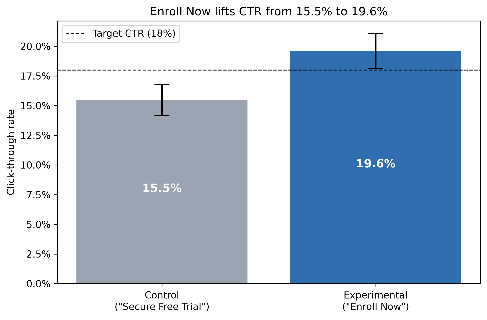

# A/B Testing Case Study: Landing Page Call-to-Action Button

A full A/B test, from experiment design to a ship/don't-ship call, for a new landing-page button ("Enroll Now" vs. "Secure Free Trial").



**Problem.** A team wants to know whether changing the call-to-action button raises click-through rate (CTR) enough to be worth shipping. The real question isn't "is there a difference?" but "is the lift big enough to act on?"

**Approach.**
- **Sized the test before seeing data:** power analysis at α = 0.05 and 80% power, with an absolute MDE of 3pp (15% → 18%). That gives 2,399 users per group, or 2 full weeks at 200 visitors/day per arm.
- **Picked a two-sample z-test for proportions** over a t-test or chi-square, since the metric is binary and both groups pass the CLT rule of thumb (np, n(1−p) ≥ 10).
- **Set the decision rule upfront:** ship if the lift is significant and the observed lift is at least the 3pp MDE. The 95% CI is reported alongside it.

**Results** (synthetic data, 5,600 users over 14 days, `ab_test_case_study.ipynb`):

| | Control ("Secure Free Trial") | Experimental ("Enroll Now") |
|---|---|---|
| Users | 2,844 | 2,756 |
| CTR | 15.5% | 19.6% |

- **Statistically significant:** z = 4.06, p < 0.001.
- **Clears the bar:** the observed lift is 4.1pp against a 3pp MDE, with a 95% CI of [2.1pp, 6.1pp].
- **Recommendation: ship "Enroll Now"**, and keep monitoring CTR and downstream conversion after rollout.

## Limitations & next steps

- **The data is simulated.** No real experiment was run. The notebook generates `ab_test_click_data.csv` from the design, with random 50/50 assignment, random arrival times and a true experimental CTR of 19%. It shows the workflow, not a real product result.
- **The CI doesn't fully clear 3pp.** Proving that the true lift is above 3pp, not just above 0, would take about 18,000 users per arm (around 90 days). The notebook shows the calculation and explains why the point-estimate rule was chosen instead.
- **There's only one metric.** A real decision would also weigh downstream conversion and guardrail metrics.
- **Next steps:** segment analysis (new vs. returning visitors, mobile vs. desktop), a post-launch holdback to track novelty effects, and sequential testing for follow-up experiments.

## Revision note

An earlier version recommended **extending the test**. In that version CTR rose from 15.3% to 18.6% (p < 0.001), but the 95% CI's lower bound (1.4pp) fell short of the 3pp bar. When I reviewed it, I found that rule didn't match the design: the test was powered to detect a lift above zero, not to prove one above 3pp, which would take about 18,000 users per arm even at the 4.1pp lift seen now. I aligned the decision rule with the power analysis and made the simulation more realistic (random 50/50 assignment, arrivals spread over two full weeks). That changed the numbers above and the recommendation to ship.

## Run it

```
pip install -r requirements.txt
jupyter notebook ab_test_case_study.ipynb
```

Run all cells top to bottom. Part 1 generates the dataset and Part 2 analyzes it.

## Project structure

```
ab_test_case_study.ipynb   main notebook (start here)
ab_test_click_data.csv     synthetic dataset generated by the notebook
ctr_by_group.png           CTR chart saved by the notebook
control_experimental.png   control vs. experimental button diagram
requirements.txt           Python dependencies
```

**Tech stack:** Python, pandas, NumPy, SciPy, statsmodels, matplotlib, Jupyter

**Contact:** [LinkedIn](https://www.linkedin.com/in/richlove-frimpong)
